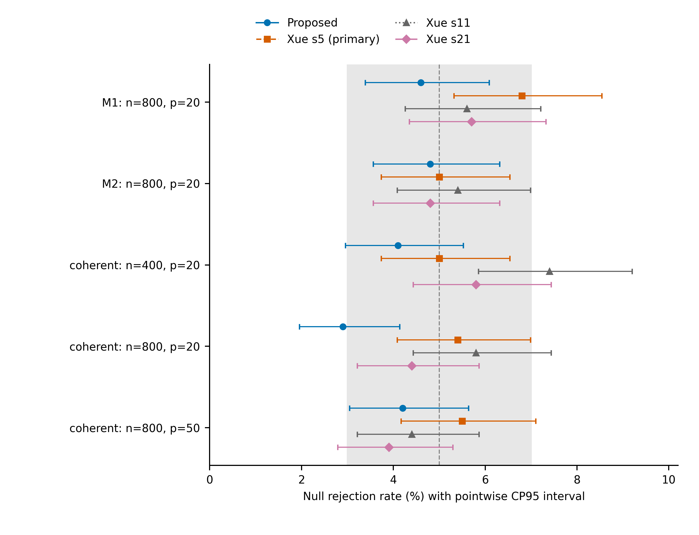
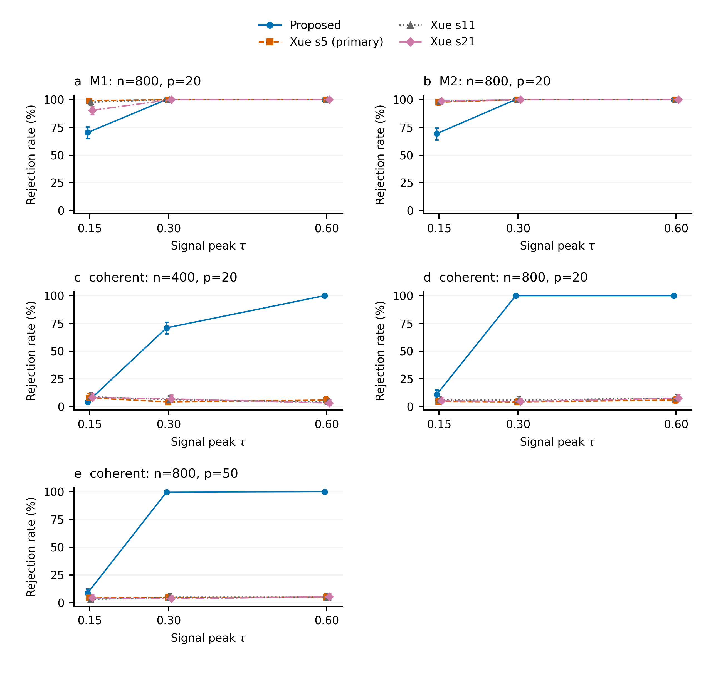
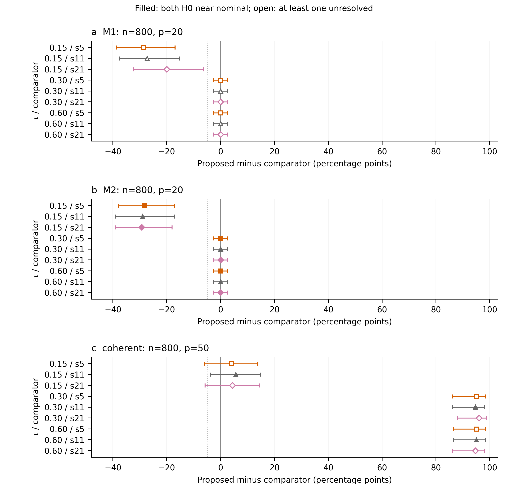
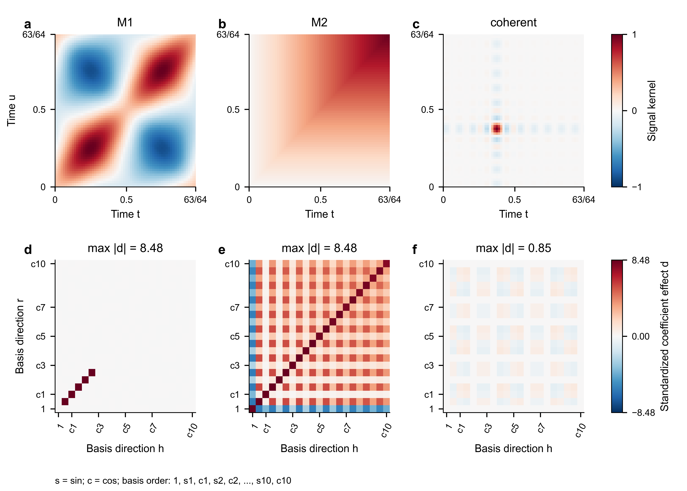

# 模拟实验

## 实验目的与比较方法

本节考察时间域最大值检验在不同协方差结构下的经验水平和检出能力，并以固定Fourier的Xue单样本EV扩展作为对照。实验同时改变信号峰值、样本量和通道数，以区分中强信号下的高功效与弱信号下的敏感性差异。对照固定采用$s=5,11,21$；其中$s=5$为原主对照，另两阶为预设敏感性设置，全部结果一并报告。比较范围限于这一单样本扩展及固定表示，不能外推为对Xue原文其他版本、基选择或自适应阶数的评价。

本文方法先估计样本均值，以残差外积构成$Q_r$，并采用
$$
\widehat\Gamma=\frac1{n-1}\sum_{r=1}^nQ_r,\qquad
\bar Q=\frac1n\sum_{r=1}^nQ_r,\qquad H_r=Q_r-\bar Q,
$$
$$
T_n=\sqrt n\|\widehat\Gamma-\Gamma_0\|_{\max},\qquad
T_n^*=\left\|\frac{\sqrt n}{n-1}\sum_{r=1}^n\xi_rH_r\right\|_{\max}.
$$
最大值遍历全部通道对和双时间网格，包括自协方差块；$\xi_r$为原始独立标准正态乘子。观察量直接按定义计算，未作学生化、坐标筛选或临界值重校准。Bootstrap重复数为$B=500$，采用$\widehat p=(1+\#\{T_b^*\ge T_n\})/(B+1)$及$\widehat p<.05$的判决。Xue扩展投影同一份观测，并将完整含噪目标作相同变换；两类方法均估计样本均值，未向对照提供潜在真系数。

## 数据生成与统一设置

各模型均在$u_\ell=\ell/64$、$\ell=0,\ldots,63$上观测，最后时点为$63/64$。受试者独立，生成均值为零，潜在创新和测量噪声均为高斯分布。记$K_0$为单通道潜在核，$K_\Delta$为受影响边的信号形状，则网格上的总体协方差为
$$
\Gamma_{jk}(u_\ell,u_h)
=\mathbb 1_{j=k}\{K_0(u_\ell,u_h)+.0025\mathbb 1_{\ell=h}\}
+\tau E_{jk}K_\Delta(u_\ell,u_h).
$$
$E$由每次重复随机抽取的两条不共享端点的通道边及其对称位置构成；该重复内全部受试者共用此支持。$H_0$取$\tau=0$。噪声在潜在过程规范化后独立加入，标准差为$.05$。各模型最大潜在边际方差及$K_\Delta$的网格绝对峰值均为1，故$\tau$就是完整协方差偏差的网格最大值。这统一了峰值尺度，但未统一总能量、有效秩或检测难度；变化在通道支持上始终稀疏。

M1采用五个基函数$\phi_{2h-1}(u)=\sqrt2\sin(2\pi hu)$、$\phi_{2h}(u)=\sqrt2\cos(2\pi hu)$的前五项，即依次为第一频率正弦、余弦，第二频率正弦、余弦，以及第三频率正弦。令$\lambda_k=(200/441)k^{-2}$，则
$$K_0(s,t)=K_\Delta(s,t)=\sum_{k=1}^{5}\lambda_k\phi_k(s)\phi_k(t).$$
在受影响边上，相应系数的跨通道协方差为$\tau\operatorname{diag}(\lambda_k)$。M2从63个独立标准布朗增量生成，每个增量方差为$1/64$，累积后乘$\sqrt{64/63}$，因此
$$K_0(s,t)=K_\Delta(s,t)=\frac{64}{63}\min(s,t).$$
起点潜在值为零，测量噪声仍存在；未对布朗路径周期化。

coherent模型令$\phi(u)=(\phi_1(u),\ldots,\phi_{20}(u))^\top$，即前十个频率的成对正余弦，取$\Lambda=I_{20}/20$、$a=\phi(3/8)/20$及$D=aa^\top$。其背景与信号分别为
$$K_0(s,t)=\phi(s)^\top\Lambda\phi(t),\qquad
K_\Delta(s,t)=f(s)f(t),\quad f(u)=\phi(u)^\top a.$$
同通道系数协方差为$\Lambda$，两条受影响边的跨通道系数协方差为$\tau D$。该构造在时间域形成相干峰值，而信号在系数坐标间分布。补充模型local采用原Fejér权重，fast采用成对$h^{-4}$谱，精确定义和完整探索结果见补充材料。

固定Fourier对照的基序以常数项起始。因此$s=5$仅覆盖M1前四个生成基，遗漏第五基；$s=11,21$覆盖其全部潜在信号。$s=21$也覆盖coherent全部潜在方向。M2潜在网格秩为63，$s=21$未完全覆盖。这里的覆盖均针对潜在过程，不等于覆盖64维测量噪声空间。

各模型的总体构造同时固定了零假设目标的含义：同通道背景在备择下保持不变，受影响的是两条边上的跨通道块。因此，高功效反映对这一稀疏偏离的检出，而非边际方差整体增加造成的简单区分。对于M1和M2，可以先按通道相关矩阵生成相关创新，再应用共同时间结构；coherent则在每条受影响边上生成归一化系数和与差$(\eta_j+\eta_k)/\sqrt2$及$(\eta_j-\eta_k)/\sqrt2$，其协方差分别为$\Lambda+\tau D$及$\Lambda-\tau D$，再还原联合高斯系数。它们实现同一已指定的总体协方差关系，不需要从观测拟合生成参数。

## 两阶段设计与统计评价

实验采用探索与独立确认两阶段设计（表1）。探索遍历三个主模型的四种形状，并在共同参考形状$(n,p)=(800,20)$增加local和fast。每个原假设单元重复500次，每个备择单元重复50次。local与coherent在相同形状和阶段共享flat原假设，物理数据只计一次。确认始终包含三个主模型的共同参考形状，并依预定探索排序为coherent增加$(400,20)$和$(800,50)$。筛选先要求本文在共同参考形状的原假设拒绝数介于15与35、$\tau=.60$拒绝数至少40；再按三个排序形状的入带数量、距25次拒绝的最大偏离、$\tau=.30$总拒绝数及固定模型次序排序。三个主模型均合格，coherent排名第一；这没有取消M1和M2的确认。

**表1　模型与实验阶段设计。** $n$为受试者数，$p$为通道数；全部模型共用$M=64$、噪声标准差$.05$、$B=500$及$\alpha=.05$。

| 阶段 | 模型及形状$(n,p)$ | 备择$\tau$ | $H_0/H_1$单元数 | 每格$R_0/R_1$ | 数据集数 |
|---|---|---|---|---|---|
| 探索 | M1、M2、coherent：$(200,20),(400,20),(800,20),(800,50)$；local、fast：$(800,20)$ | $.15,.30,.45,.60$ | 13 / 56 | 500 / 50 | 9300 |
| 确认 | M1、M2：$(800,20)$；coherent：$(400,20),(800,20),(800,50)$ | $.15,.30,.60$ | 5 / 15 | 1000 / 300 | 9500 |

两阶段共18,800份正式数据、356条方法汇总和213项配对比较，分别分析；冒烟和资源基准不进入科学结果。确认采用独立随机命名空间，$H_0$每格1000次、各备择每格300次，$\tau=.45$只有探索。由探索选择额外确认形状意味着本节评价的是锁定的有限模型集合，而非无条件覆盖任意结构的性能保证。

探索与确认回答不同问题：前者描述较宽参数矩阵并实施预定选择，后者对锁定模型和强度给出更精确估计。本文没有用确认结果再次挑选最有利的阶数或删除较弱的信号点，也没有将探索重复数加入确认分母。尤其是coherent在$(400,20)$、$\tau=.30$的探索功效68%与确认功效71%来自不同数据，应分别保留，不能互相替换。完整探索表作为模型异质性的记录，主要推断仍依据确认阶段。

拒绝率均附逐格双侧95% Clopper–Pearson区间，Monte Carlo标准误为$\sqrt{\widehat p(1-\widehat p)/R}$。即使300次全部拒绝，95%区间仍为$[98.78\%,100\%]$。确认原假设区间完全落在$[3\%,7\%]$内才支持接近；上限低于3%为明显保守，下限高于7%为明显膨胀，其余未决。该工作带未改变5%的名义检验水平，未决也不等于失准；逐格区间不提供全表同时保证。

方法共享观测，故以配对四格$a,b,c,d$分别计双方拒绝、仅本文拒绝、仅对照拒绝、双方不拒绝，差为$(b-c)/R$。对$b/R$和$c/R$分别构造CP区间，再组合$[L_b-U_c,U_b-L_c]$；确认每尾概率为$.05/(4\times45)$，保留锁定的45项家族，探索取$m=1$。校正下限大于0支持正差，上限小于0支持负差；下限大于$-.05$另支持5个百分点非劣，上限小于$-.05$支持劣于该界值。方向与非劣独立记录。只有双方原假设均支持接近时，差异才解释为工作性水平容忍范围内的功效比较，否则解释为固定名义阈值下的拒绝概率差。

工作性校准与配对差异控制的是不同层面的不确定性。前者逐格检查原假设拒绝率是否足够精确地落入预定容忍带，后者在锁定的备择比较家族内控制差值区间的多重性；二者并不合成为统一的联合5%保证。非劣也只涉及相对差不超过预定界值，不能替代对绝对功效的要求。例如两个方法都难以检出时，也可能满足非劣条件，仍应同时阅读功效点估计与区间。

## 经验水平

五个确认单元的结果显示，校准结论依赖模型与形状（表2、图1）。M1和M2在$(800,20)$的本文拒绝数分别为46/1000及48/1000，区间为$[3.39\%,6.09\%]$及$[3.56\%,6.31\%]$，均支持接近。M1三个对照为68、56、57次，区间上限分别越过7%，均未决；M2四方法则全部支持接近，因而其功效比较具有较清楚的水平参照。

coherent在$(800,50)$的四方法拒绝数依次为42、55、44、39次。本文与$s=11$支持接近，$s=5,21$未决；不能因点估计靠近5%就把四方法一概判为通过。$(400,20)$本文为41/1000，下限约2.958%，略低于3%，故保持未决。$(800,20)$本文为29/1000，区间$[1.95\%,4.14\%]$，对精确5%呈偏低，但尚不满足上限低于3%的明显保守条件；对照中$s=5,21$支持接近，$s=11$未决。这些结果要求将后续大幅拒绝概率差与实际水平的确认程度分别解释。

**表2　独立确认的经验水平。** 五个模型—形状单元乘四方法，共20项，完整整数计数、拒绝率、CP95区间及工作带评价见[主表2](tables/table02_confirm_size.md)。

## 功效与配对比较

规范化M1和M2在已考察的$\tau=.30,.60$下进入高功效区域，但弱信号损失清楚可见（表3、图2）。M1在$(800,20)$、$\tau=.15$时本文拒绝211/300，功效70.33%；三个对照分别为297、293、271次，即99.00%、97.67%、90.33%。相应差值为$-28.67,-27.33,-20.00$个百分点，校正区间均低于零，且上限均低于$-5$个百分点。由于M1对照的原假设评价未决，这首先是名义拒绝概率上的负差证据。

M2在同一弱信号下本文拒绝208/300，功效69.33%，三个对照为293、295、296次，即97.67%、98.33%、98.67%。三个校正区间同样全低于零，上限均低于$-5$个百分点；双方原假设均支持接近，因此这是预定水平容忍范围内的弱信号功效劣势。原汇总将M1/M2这六项标为“方向证据不足”，与区间不符，本节修正为负差证据，保留全部原计数与区间（图3）。

在$\tau=.30,.60$，M1/M2四方法均为300/300。相同有限样本全拒绝不能证明真实功效相等或本文更优；配对区间仍约为$[-2.693,2.693]$个百分点。M2六项比较支持5个百分点非劣，M1对应比较也满足该差异界值，但其水平解释仍受上述限制。弱信号的六项负差与中强信号的饱和共同限定了方法适用范围，不能用后者掩盖前者。

coherent提供了不同的结构性表现。$(800,50)$、$\tau=.30$时本文为299/300，三个对照为14、15、11次；$\tau=.60$时依次为300、15、15、16次。与$s=11$的差值分别为94.67和95.00个百分点，经45项校正后的区间分别为$[86.02,98.08]$和$[86.47,98.27]$个百分点。本文与该对照的原假设均支持接近，因此这两个强差异同时具有工作性校准参照。与$s=5,21$的差也为正，但相应对照水平未决，仍只作名义差解释；$s=11$的较清楚校准不改变$s=5$的原主对照身份。

这种优势没有延伸到coherent弱信号。$\tau=.15$时，$(400,20),(800,20),(800,50)$本文功效仅为4.33%、11.00%、8.67%。在$(800,50)$对$s=11$的校正差区间跨零，虽支持5个百分点非劣，却未证明正差；低绝对功效也意味着该信号水平仍难以检出。全部45项确认比较中，18项支持正差，15项仅支持非劣而未证明正差，6项支持负差，另6项方向未决且未建立非劣；正差本身也满足非劣。只有12项比较的双方原假设均支持接近，故这些统计方向不能一律改称等实际水平优势。

coherent在$(800,20)$的中强信号同样全部拒绝，但其本文原假设拒绝率偏低。此处并未依据这一下偏重新调临界值，也未将对应结果重新包装为水平匹配比较。保留既有判决既揭示了较大的拒绝概率差，也让读者看到校准结论的限制；若未来需要更严格的实际水平匹配，应另行设计独立评价，不能从本批确认数据事后调整阈值得到。

**表3　独立确认的功效。** 十五个备择单元乘四方法，共60项，各格$R=300$；完整计数和CP95区间见[主表3](tables/table03_confirm_power.md)，全部45项配对及探索结果见[补充材料](SIMULATION_SUPPLEMENT_ZH.md)。

## 样本量、维数与信号结构

coherent的独立确认显示，在$p=20$、$\tau=.30$时，$n$由400增至800，本文功效从213/300即71.00%增至300/300；弱信号则由13/300增至33/300。不同$n$使用独立数据，这是一项描述性样本量趋势，没有另作趋势显著性声明。固定$n=800$、$p$由20增至50时，$\tau=.15$功效从11.00%降至8.67%，$\tau=.30$从100%变为99.67%，$\tau=.60$均全拒绝。弱信号的下降说明强信号饱和不能被解释为维数增加没有代价。

M1/M2的其他形状仅有探索证据。$p=20$、$\tau=.30$下，$n=200,400,800$时本文M1功效为64%、100%、100%，M2为62%、100%、100%；但每格只有50次，区间较宽，且小样本对照水平可能偏高。例如M2的$(200,20)$、$s=11,21$探索水平为13.8%、19.6%，不能脱离水平直接赞成功效。local和fast的探索差异同样只用于结构参照，不并入确认结论。

图4用冻结生成公式和实际离散投影解释为何统一峰值不产生统一检测难度。M1/M2的信号核与背景相同，coherent则以$f(s)f(t)$叠加在平坦谱背景上。对单通道实际投影$P_s$，令$S_s=P_s(K_0+.0025I)P_s^\top$、$A_s=\tau P_sK_\Delta P_s^\top$，图中系数效应为$\sqrt{800}(A_s)_{rh}/\sqrt{(S_s)_{rr}(S_s)_{hh}}$。这是原假设下独立跨通道边的总体诊断，分母不包含同通道投影协方差$(S_s)_{rh}^2$。相干时间峰可由多个系数方向共同形成，故时间域最大值与系数域最大值可能具有不同敏感性。$s=21$已覆盖coherent潜在信号，不能把其结果仅归为截断遗漏；Brownian存在未覆盖谱尾，也未保证本文在弱信号占优。

这一确定性结构图没有复现经验学生化、有限样本分母和全部通道的多重比较阈值，不能直接预测功效，也不是唯一机制的因果证明。本节支持的是：在已考察的$\tau=.30,.60$下，规范化M1/M2具有较高功效，coherent的部分确认形状还呈现兼具工作性校准参照的对照优势；弱信号和其他形状需要分别评价。当前结果限于独立高斯受试者、64点网格、至多50通道和上述稀疏支持，尚未验证非高斯稳健性、通道数$p>n$、双样本推广或实验点之间的连续强度范围。
